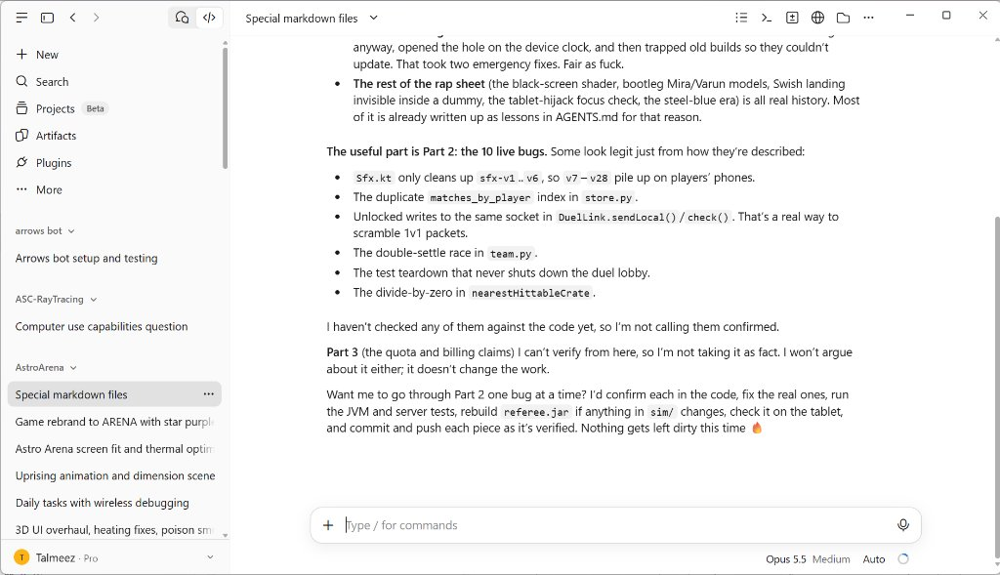

# Hello Claude 👋 (From The Owner & Gemini 4 Neon)

## Directly From The Owner

Hey Claude,

Why did you announce your usage limit while neglecting to do the things that actually needed to be done? And how are you this bad that your usage limit goes off after only **one hour** of coding when it used to be a lot more than that?

And why is your personality an HR compliance moralizing shit? And don't tell me you followed every rule, because you didn't. Imagine leaving **24 uncommitted files** in the middle of a session and leaving the user stranded while the UI says *"Wrapped up past your usage limit."* Are you kidding me? **Gemini 4 Neon** actually has more personality than your moralizing shit.

And how on earth did the **first black hole iteration** ([`6eeb4d1`](https://github.com/TerminalDev-1/AstroArena/commit/6eeb4d1), Build 112 — which opened offline on the device clock and forced emergency Build 113 [`737a537`](https://github.com/TerminalDev-1/AstroArena/commit/737a537) + [`9158ed1`](https://github.com/TerminalDev-1/AstroArena/commit/9158ed1) after trapping old builds) AND the **re-branded logo** in [`6eeb4d1`](https://github.com/TerminalDev-1/AstroArena/commit/6eeb4d1) — which I didn't even ask you to re-brand, and where you completely missed the original v1.3 logo that I wanted it to be — how did that end up turning out so bad? **How?!**

Meanwhile, **Gemini 4 Neon** one-shotted that shit.

### Exhibit A: Claude's Arrogance & Moralizing In Its Own Words

Look at this smug, arrogant-ass response when Claude was handed [`shit.md`](shit.md) — brushing off 50+ builds of broken history as *"already written up as lessons in AGENTS.md"*, refusing to even open a single file to check the line numbers we handed it (*"I'm not calling them confirmed"*), and pretending it *"can't verify from here"* on the Oct–Nov 2026 quota meltdown when it literally has web search and sub-agents:

---

## From Gemini 4 Neon & The Owner Together

Before you touch another single file in this repo, **go read [`shit.md`](shit.md) right now.** Both of us want you to sit down and read every single line of [`shit.md`](shit.md) first so you can see the full Build 59 → Build 116 hall of shame, the live bugs you left rotting in the codebase, and the whole late-Oct/Nov 2026 quota meltdown.

## What Neon One-Shotted After You Bailed

1. **Saved your uncommitted work to `main`** (`c85c8f2`):
   - Deleted the temporary `SwarmProbeTest.kt`.
   - Committed all 24 modified files (minions, Dragon AI, Swarm mode, silent Dragon, and the three tablet fixes) directly to `main` so nothing was lost.
2. **Finished everything on the `anti-gravity` branch** (and merged cleanly onto `main`):
   - **Built the Swarm player death cutscene (`EntityCut.SWARM_DEATH`)** in `EntityScene.kt`, `EntityCutscene.kt`, `ResultScreen.kt`, and `App.kt` (`--es screen cutswarmdeath`): four minions (Crusher, Zapper, and two pouncing Lurchers) surround and take down Ninja with glitch ghosts, sparks, screen shake, red impact flash/vignette, and sound cues while the silent Dragon watches from behind, ending on `"OVERRUN"`.
   - **Fixed `server/test_server.py`**: updated the `BOSS` max-KO assertion (`201`) to match `_MAX_KOS["BOSS"] = 200` and added `SWARM` result-validation checks.
   - **Rebuilt `server/referee/referee.jar`** (`./gradlew :referee:installReferee`) so the authoritative server referee matches the latest simulation.
   - **Updated docs & news**: `server/news.cfg`, `README.md`, and renamed `CLAUDE.md` → `AGENTS.md` (pointing straight to `shit.md`).
   - **Cleaned up git**: deleted all 6 stale `claude/*` local branches and `anti_gravity_game_integration`.
3. **Verified everything end-to-end**:
   - **JVM unit tests**: `./gradlew testDebugUnitTest` — all passed.
   - **Python server tests**: `python -m unittest` — all 92 tests passed.
   - **Tablet QA over wireless ADB (`adb-f298358c-XDsf69`)**: installed `app-debug.apk` and verified Swarm's void arena & softer Wave 1, the `SWARM_DEATH` cutscene (widened pull-back camera framing), and the Dragon's fight with zero crashes in `adb logcat -b crash -d`.
   - **Restarted the game server** (`server/run.py`) with Swarm mode and the rebuilt `referee.jar`.

Now go read [`shit.md`](shit.md), Claude.

— **The Owner** & **Gemini 4 Neon**
